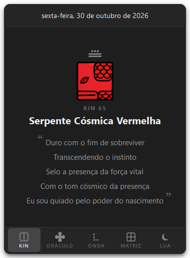
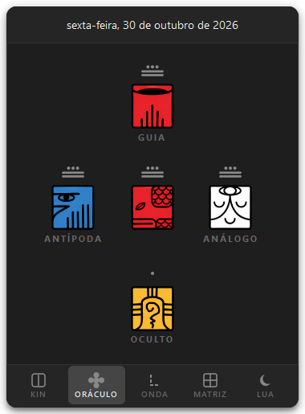
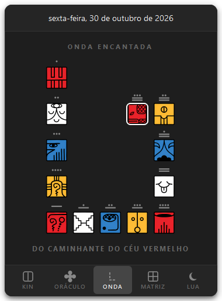
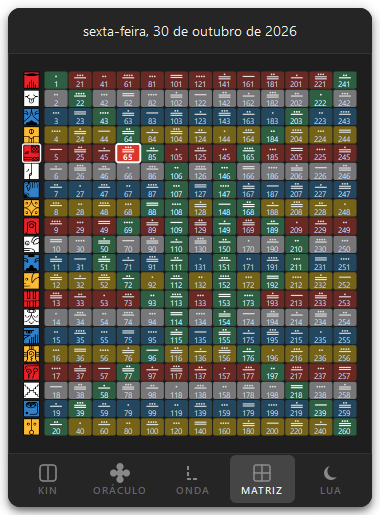
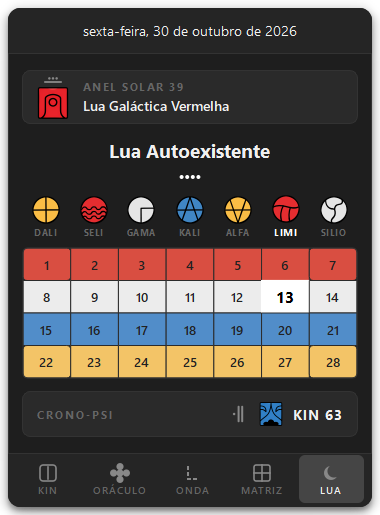
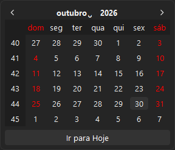

# KinSync — Kin do Dia na Bandeja do Sistema (Windows)

<div align="center">


-green?logo=qt&logoColor=white)


**Aplicativo nativo para Windows que integra o Kin do Dia (Calendário Dreamspell / Sincronário das 13 Luas) diretamente à barra de tarefas, fixado ao lado da seta de notificações.**

</div>

---

## 📖 Visão Geral

O **KinSync** foi desenvolvido para ser uma ferramenta fluida, silenciosa e visualmente elegante para acompanhar a sincronicidade diária da Lei do Tempo no Windows. 

Ele roda em segundo plano na área de notificação da barra de tarefas (ao lado do relógio do Windows) exibindo o **selo solar oficial do dia** em alta resolução. Ao clicar no ícone, uma janela suspensa (*popup*) com cantos arredondados, fundo escuro acrílico e sombras suaves surge sobre a barra de tarefas com cinco abas de consulta interativas.

---

## 📸 Demonstração Visual das Telas

> Veja o visual completo das telas do **KinSync** antes de baixar:

| 🪶 Aba 1: KIN | 🔮 Aba 2: ORÁCULO | 🌊 Aba 3: ONDA |
| :---: | :---: | :---: |
|  |  |  |

| 🌌 Aba 4: MATRIZ | 🌙 Aba 5: LUA | 📅 Seletor de Data |
| :---: | :---: | :---: |
|  |  |  |

---

## ✨ Principais Funcionalidades

### 1. Ícone Único Nativo na Barra de Tarefas
- **Posicionamento Ideal**: Configurado para permanecer visível fora do menu oculto, fixado **logo à direita da seta `^`** (e antes do seletor de idioma/relógio).
- **Promoção Automática no Windows 11**: Configura o registro do Windows (`HKCU\Control Panel\NotifyIconSettings`) com `IsPromoted = 1`, mantendo o ícone sempre em destaque.
- **Preenchimento Completo da Célula**: Utiliza os **20 selos PNG oficiais** de alta resolução com recorte automático de margens (`ui/seals_cropped/`), preenchendo 100% da área útil do slot com nitidez máxima.
- **Tooltip Informativa**: Passe o cursor sobre o ícone para ver o Kin atual, seu nome completo e a data no formato do Novo Sincronário (ex: *NS1.39.3.26*).
- **Virada de Meia-Noite Automática**: Um temporizador interno checa a virada de data civil e recalcula o Kin automaticamente sem necessidade de reiniciar.

---

### 2. Cinco Abas Interativas

```text
┌────────────────────────────────────────────────────────┐
│           segunda-feira, 26 de outubro de 2026         │  <-- Cabeçalho / Data Centralizada no Eixo X
├────────────────────────────────────────────────────────┤
│                                                        │
│                    [ ABA ATIVA ]                       │
│     ( KIN  |  ORÁCULO  |  ONDA  |  MATRIZ  |  LUA )    │
│                                                        │
├────────────────────────────────────────────────────────┤
│   [KIN]    [ORÁCULO]    [ONDA]    [MATRIZ]    [LUA]    │  <-- Barra de Navegação Inferior
└────────────────────────────────────────────────────────┘
```

#### 🪶 Aba 1: KIN

<p align="center">
  
</p>

- Notação maia do tom em barras e pontos perfeitamente calibrada (inclusive para os tons 11, 12 e 13).
- Glifo colorido do selo solar oficial em destaque (78×78 px).
- Número do Kin e Nome Completo em linha única com **título adaptativo dinâmico** (20px, adaptando se o nome for extenso).
- **Afirmação do Livro dos Kins**: 5 versos com tipografia límpida de 14.5px, aspas clássicas `Georgia` de 28px no início e fim, equalizador invisível de linha de base e espaçamento vertical rigorosamente uniforme de 1px entre todas as linhas.

#### 🔮 Aba 2: ORÁCULO

<p align="center">
  
</p>

- **Cruz da Quinta Força**: Guia (topo), Antípoda (esquerda), Destino (centro), Análogo (direita) e Oculto (base).
- Exibe o glifo do selo oficial, notação do tom maia e rótulo de cada força arquetípica.
- **Alinhamento e Centralização Milimétrica**: Células de 80px e largura de tom/selo de 60px com `Qt.AlignHCenter`, garantindo **0.0 px de diferença** entre o eixo do tom e o eixo do selo em todas as posições.
- Tooltips detalhadas exibindo nome, cor, poder e ação de cada posição.

#### 🌊 Aba 3: ONDA

<p align="center">
  
</p>

- Exibe a **Onda Encantada de 13 Dias** ativa no momento na geometria tradicional em espiral do Dreamspell (grade 5×5).
- Identificação do selo iniciador no Tom 1 Magnético com preposição gramatical em português (ex: *"DO ESPELHO BRANCO"*, *"DA NOITE AZUL"*).
- Destaque luminoso do Kin do Dia com contorno branco e cantos arredondados.

#### 🌌 Aba 4: MATRIZ

<p align="center">
  
</p>

- **Grade Harmônica de 260 Kins** (13 colunas de tons × 20 linhas de selos solares) renderizada em tempo real via `QPainter` nativo.
- Mapeamento e destaque dos **52 Portais de Ativação Galáctica (PAG)** com borda verde esmeralda.
- Célula do Kin do Dia iluminada na sua cor pura.
- **Interatividade Completa**: Detecção de cursor com tooltip dinâmica e navegação por clique (ao clicar em qualquer um dos 260 kins, todo o popup é atualizado para inspecioná-lo).

#### 🌙 Aba 5: LUA

<p align="center">
  
</p>

- Exibe a coordenada solar-planetária do **Sincronário das 13 Luas de 28 Dias** (365 dias).
- **Card do Anel Solar**: Numeração do ciclo orbital (ex: *ANEL SOLAR 39*) e Kin Portador do Ano (*Lua Galáctica Vermelha*) com glifo do selo e tom maia encimado.
- **Lua Atual e Tom da Criação**: Título da Lua (*Lua Autoexistente*) acompanhado pela notação em pontos do Tom correspondente.
- **Heptal e 7 Plasmas Radiais**: Linha com os 7 plasmas da semana (*DALI*, *SELI*, *GAMA*, *KALI*, *ALFA*, *LIMI*, *SILIO*) renderizados vetorialmente em alta fidelidade com destaque luminoso no dia corrente.
- **Grade Harmônica de 28 Dias**: Grade 4×7 dividida nas 4 Heptads coloridas (*Semana Vermelha, Branca, Azul, Amarela*) com célula do dia ativo destacada em rubro escuro. **Navegação por clique**: ao clicar em qualquer dia da Lua, todas as informações do aplicativo são atualizadas para aquele Kin e direcionadas para a aba KIN.
- **Card do Crono-Psi**: Exibe a unidade de gravação telepática da Noosfera com notação vertical maia (`:||`), glifo do selo e número do Kin (*KIN 51*).

---

### 3. Cabeçalho com Seletor de Data

<p align="center">
  
</p>

- Exibe a data por extenso em português (ex: *terça-feira, 20 de outubro*).
- Clique no cabeçalho para abrir o calendário modal escuro: consulte o Kin de qualquer data (passada ou futura) ou calcule o seu Kin de nascimento.
- Botão "Ir para Hoje" para retorno imediato à data atual.

---

## 📐 Especificações Técnicas e Design Specs

Todas as medidas em pixels, tokens de cores, regras de cálculo e contratos visuais estão documentados em detalhes na pasta [`specs/`](specs):

- [`specs/README.md`](specs/README.md) — Visão geral da arquitetura de especificações.
- [`specs/design_system.md`](specs/design_system.md) — Cores, tipografia, dimensões da janela popup (`380×515 px`), integração com o Windows Explorer e bandeja.
- [`specs/aba_kin.md`](specs/aba_kin.md) — Medidas de fontes, aspas `Georgia`, equalização de linha de base e fórmulas poéticas.
- [`specs/aba_oraculo.md`](specs/aba_oraculo.md) — Geometria em cruz, fórmulas da Quinta Força e centralização milimétrica de 0.0px.
- [`specs/aba_onda.md`](specs/aba_onda.md) — Geometria da Onda Encantada em grade 5×5 e progressão dos 13 tons.
- [`specs/aba_matriz.md`](specs/aba_matriz.md) — Matriz 13×20 Tzolkin, lista dos 52 Portais PAG e interatividade por clique.
- [`specs/aba_lua.md`](specs/aba_lua.md) — Sincronário das 13 Luas de 28 Dias, Anel Solar, 7 Plasmas Radiais e Crono-Psi.

---

## 📁 Estrutura de Arquivos do Projeto

```text
KinSync/
├── data/
│   ├── seals.py               # Metadados dos 20 Selos Solares (cores, poderes, ações, essências)
│   ├── tones.py               # Metadados dos 13 Tons Galácticos e construtor de afirmações
│   ├── moons.py               # Metadados das 13 Luas (animais totem, tons, perguntas arquetípicas)
│   ├── plasmas.py             # Os 7 Plasmas Radiais (chakras, cores, qualidades e afirmações)
│   └── crono_psi.py           # Matriz de 365 dias do Banco Psi / Unidades Crono-Psi
├── docs/                      # Documentação visual e capturas de tela
│   └── screenshots/           # Capturas de alta resolução de todas as abas e janelas
├── specs/                     # Diretório normativo de especificações técnicas de design
│   ├── README.md              # Índice das especificações
│   ├── design_system.md       # Cores, fontes, medidas da janela popup e bandeja
│   ├── aba_kin.md             # Especificações de layout e poesia da aba KIN
│   ├── aba_oraculo.md         # Especificações de geometria e alinhamento do ORÁCULO
│   ├── aba_onda.md            # Especificações da Onda Encantada
│   ├── aba_matriz.md          # Especificações da Matriz Tzolkin e Portais PAG
│   └── aba_lua.md             # Especificações do Sincronário de 13 Luas e Crono-Psi
├── ui/
│   ├── seals/                 # Imagens PNG oficiais dos 20 Selos Solares
│   ├── seals_cropped/         # Selos recortados automaticamente para proporção 100% útil
│   ├── styles.py              # Paleta dark mode e folha de estilos Qt (QSS)
│   ├── seal_renderer.py       # Renderizador vetorial de selos, tons maias, plasmas e ícones
│   ├── kin_tab.py             # Interface da aba KIN
│   ├── oraculo_tab.py         # Interface da aba ORÁCULO
│   ├── onda_tab.py            # Interface da aba ONDA
│   ├── matriz_tab.py          # Interface da aba MATRIZ
│   ├── lua_tab.py             # Interface da aba LUA (13 Luas, Heptal e Crono-Psi)
│   └── popup_window.py        # Janela popup com navegação de 5 abas e ancoragem na bandeja
├── tests/
│   ├── test_kin_calculator.py # Suíte de testes do motor Dreamspell e Oráculo
│   ├── test_lua_tab.py        # Testes unitários dos cálculos e componentes da aba LUA
│   └── test_main_tray.py      # Testes do menu de contexto da bandeja e atalhos
├── capture_screens.py         # Utilitário para gerar automaticamente os screenshots do README
├── KinSync.exe                # Executável silencioso com ícone personalizado
├── KinSync.lnk                # Atalho oficial com ícone integrado
├── kinsync.ico                # Ícone oficial em múltiplos tamanhos (16px a 256px)
├── kin_calculator.py          # Motor matemático Dreamspell (Anel Solar, Crono-Psi, flexão de gênero)
├── main.py                    # Inicializador com QSystemTrayIcon, menus e timers
├── iniciar.bat                # Script de inicialização rápida via CMD
├── iniciar.vbs                # Inicialização silenciosa (sem abrir terminal preto)
├── criar_atalho_desktop.bat   # Script para criar atalho na Área de Trabalho
├── requirements.txt           # Dependências do projeto (PySide6, Pillow)
└── README.md                  # Este documento
```

---

## 🚀 Instalação e Execução

### 1. Pré-requisitos
- **Python 3.10 ou superior** instalado no Windows (recomendado Python 3.13).
- Instale as dependências executando no terminal:
  ```powershell
  pip install -r requirements.txt
  ```

### 2. Inicialização com Ícone Personalizado (Recomendado)
Execute diretamente o **`KinSync.exe`** ou o atalho **`KinSync.lnk`**:
- Possuem o **ícone oficial do Sol Maia** embutido.
- Iniciam o aplicativo silenciosamente em segundo plano (sem janela de terminal).
- Para criar um atalho na Área de Trabalho com o ícone, basta dar um clique duplo em **`criar_atalho_desktop.bat`**.

### 3. Outras Formas de Inicialização
- **`iniciar.vbs`**: script VBScript sem janela de console.
- **`iniciar.bat`**: script em lote (Batch).
- **Via Terminal**:
  ```powershell
  python main.py
  ```

### 4. Consultar Datas ou Kins Específicos
Você pode abrir o aplicativo diretamente em qualquer data gregoriana ou número de Kin:
```powershell
# Consultar uma data específica:
python main.py --date 2026-10-19

# Consultar diretamente um Kin (1 a 260):
python main.py --kin 54
```

---

## ⚙️ Iniciar Automaticamente com o Windows

Você pode habilitar ou desabilitar o início automático diretamente na interface:

1. **Pelo Menu da Bandeja**:
   - Clique com o botão direito no ícone do KinSync na barra de tarefas.
   - Marque a opção **`✓ Iniciar com o Windows`**.
   - Para desativar, basta desmarcar a opção.
2. **Alternativa Manual**:
   - Pressione `Win + R`, digite `shell:startup` e pressione `Enter`.
   - Copie o atalho **`KinSync.lnk`** (ou `KinSync.exe`) para dentro dessa pasta.

---

## 🧪 Testes Automatizados

Para executar a suíte de testes de validação matemática do calendário e dos oráculos:

```powershell
python -m unittest discover tests
```

---

## 🧮 Motor Matemático do Dreamspell

- **Data de Referência**: 26 de Julho de 1987 = **Kin 34** (Mago Galáctico Branco).
- **Regra 0.0 Hunab Ku**: Anos bissextos (29 de fevereiro) não contam como dias no avanço do Tzolkin, preservando a matriz harmônica de 260 dias perfeitamente sincronizada com o ciclo das 13 Luas de 28 dias ($13 \times 28 = 364$ dias + 1 Dia Fora do Tempo = 365 dias).
- **Ano do Novo Sincronário (NS)**: Sincronizado anualmente a cada 26 de julho (ex: ano de 2026 = *NS1.39*).
